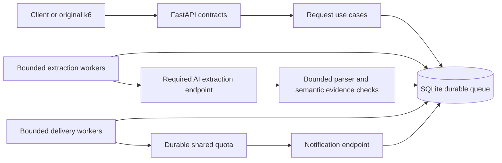
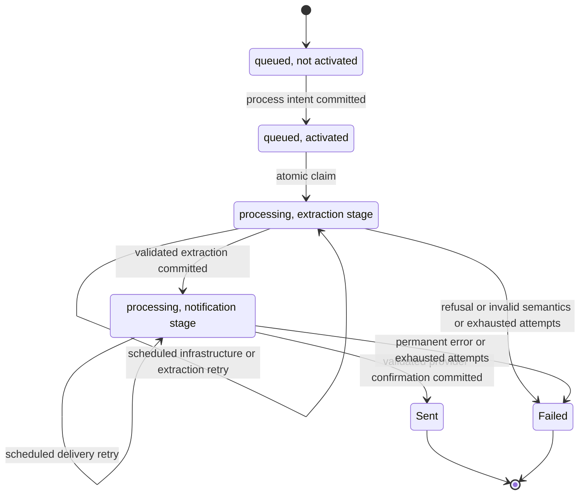
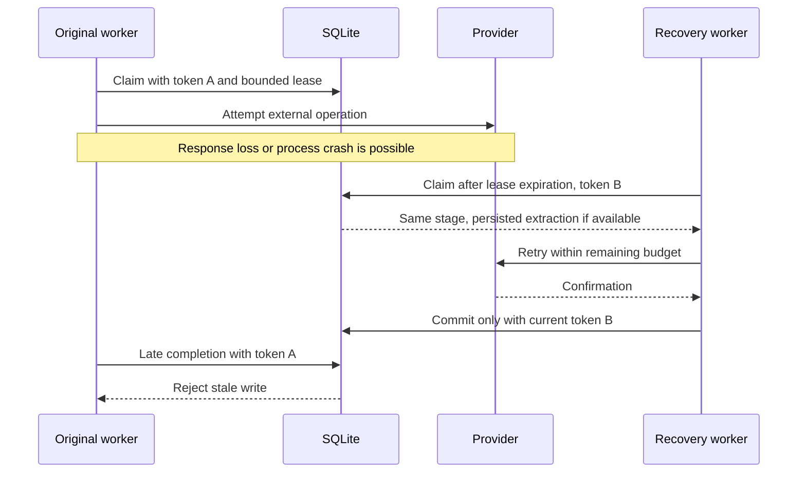

# Architecture and delivery guarantees

This independent Python 3.12 service uses FastAPI, Pydantic v2, async HTTPX and
SQLite. The supplied provider and original k6 scripts remain unchanged.

## Components

`api.py` owns HTTP translation, input schemas and resource lifetime. `service.py`
owns creation, activation and retrieval through a repository protocol. Domain
records, statuses and failure families do not depend on FastAPI. The extractor
and sender ports let workers use real HTTP clients or deterministic test doubles.
`extraction.py` owns the only route from untrusted AI text to a validated candidate;
its semantic guard may veto a candidate but never supplies replacement content.

One Uvicorn process runs two bounded worker pools. Each integration has its own
bounded HTTPX client, avoiding delivery starvation by extraction connections.
Requests activate durable work instead of spawning per-request background tasks.
The requests table is the queue: no database/broker dual-write problem exists.
SQLite work runs through aiosqlite, not synchronously on the event loop.

## Lifecycle

Only `queued`, `processing`, `sent`, and `failed` are public statuses. An independent
activation timestamp distinguishes registration from dispatch intent. Creation
alone never calls the AI. Repeated process calls preserve activation time, retry
schedule, counters and terminal states. Equal creation payloads intentionally get
different UUIDs; deduplicating identical text would lose legitimate requests.
Creation idempotency keys are not implemented.

The extraction result, prompt/parser version and repair flag are committed before
the notification stage. Delivery retries and restarts reuse that exact result.
They never rerun extraction or combine fields from different AI responses.

## Transactions, leases and recovery

SQLite uses WAL, `synchronous=FULL`, a one-second busy timeout, and local durable
storage. A connection lock serializes complete transactions. `BEGIN IMMEDIATE`
also arbitrates independent connections. No transaction includes HTTP, backoff,
rate-limit waiting or other long-lived work. Schema version 2 migrates version 1
in place; newer unknown schema versions fail startup rather than being overwritten.

A claim atomically increments the stage-specific attempt counter, records an
attempt and gives it a random lease token with expiration. Only that token while
unexpired can commit a result. Expired attempts are marked abandoned. Recovery
reclaims eligible work or marks an abandoned final attempt terminally failed.
Recovered notify-stage work preserves its validated extraction.

The default lease is 30 seconds, exceeding both total attempt deadlines plus a
storage margin. Leases do not need heartbeat renewal for these bounded attempts.
Process recovery requires workers and storage to become available. Wall-clock
jumps, machine suspension and delayed packets remain limitations; this is a
single-host design, not a distributed-clock coordination protocol.

Cancellation-safe transaction cleanup retains the connection lock until rollback
finishes, even under repeated cancellation. Shutdown stops acquisition, waits for
in-flight work, then cancels within a configured grace period. A worker rechecks
the stop signal after obtaining quota. HTTP clients and storage close after workers.

## Attempts and failure families

The default budget is three extraction attempts and three notification attempts.
Separate counters prevent a delivery retry from consuming extraction budget.
Retries use capped exponential backoff with jitter and a durable next-attempt
timestamp; sleeping request tasks and nested transport retries are not used.

- `extraction`: malformed envelope/output, invalid fields or missing information.
- `semantic`: recipient/channel mismatch, incomplete/changed message or inability
  to establish correspondence to the original intent.
- `refusal`: explicit AI refusal or content-filter decision. Terminal immediately.
- `infrastructure`: connection failures, deadlines, credentials, lost leases.
- `delivery`: notification HTTP failure or invalid provider confirmation.

Each attempt retains its outcome. Terminal request categories and all-attempt
categories are reported separately: a request may recover from an infrastructure
failure and later finish successfully or fail for another reason.

Explicit refusals, ambiguous output, semantic failures and clearly missing input
are not retried to seek a more permissive answer. Recoverable transport/5xx/429
errors and stochastic malformed or incomplete AI outputs may retry within budget.
No local fallback bypasses the extraction endpoint.

## Provider quota and uncertain delivery

The mock notification endpoint admits 50 attempts in a sliding 10-second window
and separately limits concurrent notifications to 50. Its configured random
notification failure probability is zero. AI extraction has no supplied quota
or semaphore, but our application bounds concurrent calls.

Quota permits, spacing and cooldown are shared in SQLite and survive restart.
The initial smoothing target is 4.5 attempts/s, below the provider's 5/s average
capacity. Notification workers acquire quota before claiming work. Unused permits
are conservatively counted. A restart extends cooldown by the quota window plus
the total notification attempt deadline, covering old in-flight requests.
429 responses extend shared cooldown, including on the final allowed attempt.
Retry-After is honored when valid. Other provider clients and network arrival
timing can still cause 429; a local limiter cannot reserve remote capacity.

**Exactly-once external delivery is not available.** The provider has no
idempotency support or delivery lookup. It may accept a notification before a
response is lost, or before the application crashes ahead of its durable commit.
Retrying favors eventual confirmation but can duplicate the external side effect.
Leases prevent stale writes, not those nontransactional external effects.

`sent` means a validated HTTP 200 with `status=delivered` and a nonblank provider
ID was durably committed. IDs from this mock are not unique and are never used as
local primary keys. An invalid success body fails as `delivery_unknown` without
automatic retransmission. `failed` does not prove that an uncertain external
attempt delivered nothing. This mock does not actually send email or SMS.

## Admission, security and operations

The default capacity is 10,000 nonterminal requests, including unactivated ones.
Admission and insertion are atomic. Raw body bytes, input characters, AI response
bytes, validated fields, workers, connections and retry counts are bounded.
Terminal records and audit history are retained; automatic retention is not
implemented. Monitor disk usage and make consistent SQLite backups before manual
maintenance. Deleting the named Docker volume destroys accepted work and evidence.

The API's readiness check covers storage and worker task liveness. It does not
prove provider availability or worker progress. Track oldest pending work and
terminal progress separately. Logs contain request IDs and categorized outcomes,
not recipients, messages, raw AI output or API keys. The durable database contains
personal data by necessity; filesystem access and retention need operational care.

Provider URLs come from trusted configuration, never model output. Redirects and
environment proxy inheritance are disabled. No AI text reaches a shell, evaluator,
template engine, SQL statement, or dynamically selected endpoint.

The supplied stack is a local assessment environment: public development key,
unauthenticated API, HTTP, published ports and anonymous Grafana administration.
Public production deployment requires authentication/authorization, abuse controls,
TLS, restricted network exposure and a reviewed dependency/image baseline.

## Reuse and deliberate limits

The backend challenge informed durable activation, leases, quota and cancellation
tests. This project has its own implementation, database, tests and dependencies.
It does not import or mutate the neighboring repository. Its two-stage pipeline,
failure taxonomy and semantic safeguards are specific to the AI challenge.

No RAG, agent framework, workflow framework, broker or additional infrastructure is
needed at this scale. Worker counts are measured hypotheses, not optimality claims.
See [semantic scope](semantics.md), [testing](testing.md) and [measurements](validation.md).
