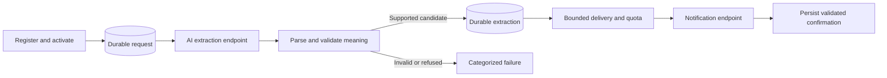

# AI Engineer Challenge: Durable Notification Service

A Python 3.12 / FastAPI service that accepts natural-language notification requests,
uses the **required supplied AI endpoint**, validates its output, and sends only
semantically supported email or SMS notifications.

The supplied mock is intentionally noisy and also has deterministic semantic
limitations. HTTP success, parseable JSON, and a provider acknowledgment are three
different observations. The service never reconstructs a truncated message or
turns an AI refusal into a notification to improve delivery statistics.

## Quick start

```sh
docker compose up -d --build --wait app influxdb grafana
curl --fail http://localhost:5000/health/ready
```

- Application and Swagger: http://localhost:5000/docs
- Original provider documentation: http://localhost:3001/docs
- Original Grafana scorecard: http://localhost:3000/d/ia-performance-scorecard/

If port 5000 is occupied, follow the [host-port override](docs/testing.md#start-the-real-stack).
The tested local override uses port 15000 while preserving internal port 5000 and
k6's original target. The Compose environment supplies the public challenge key;
no private API credentials or external model subscription are required.

The app runs as a non-root user. A named volume persists SQLite across container
recreation. Do not remove that volume if accepted requests or evidence must survive.
The supplied Grafana authentication and public development key are for local
assessment, not an Internet-facing deployment.

## Original API contracts

The entry point remains `app/main.py` and exports `app`.

1. `POST /v1/requests` with `{"user_input":"..."}` returns **201** and `{"id":"..."}`
   after a durable commit. Registration alone does not start AI processing.
2. `POST /v1/requests/{id}/process` durably activates work and returns **202**, or
   **200** for an already terminal request. Repeated activation never resets work.
3. `GET /v1/requests/{id}` returns **200** and exactly `{"id":"...","status":"..."}`.
   Public states remain `queued`, `processing`, `sent`, and `failed`.

Example input that the mock can represent without changing its message:

```json
{"user_input":"Send email to alex@example.org: your order is ready."}
```

Missing IDs return 404, invalid input 422, excessive bodies 413, and unavailable
storage or full admission capacity 503. `/health/ready` checks storage and worker
liveness; it does not guarantee an empty backlog or provider availability.

## Processing and correctness



- Separate bounded extraction and notification worker pools, with independent
  HTTP connection limits and attempt budgets.
- Known aliases, Markdown and unequivocal syntax errors are recoverable. Missing
  fields, ambiguous JSON and truncated content are never filled in locally.
- A deliberately conservative evidence grammar verifies the complete AI candidate
  against explicit routing/body information. Unsupported phrasing fails closed;
  this is not a universal natural-language understanding guarantee.
- Message capitalization, punctuation, numbers, times and content must match.
  This can reject outputs that are structurally valid but inaccurate.
- Explicit refusals terminate immediately. The application does not repeatedly
  ask until the mock produces a permissive answer.
- Durable intermediate results mean notification retries never repeat extraction.
- Atomic leases, stale-owner fencing, persisted retry schedules and shared provider
  quota allow bounded recovery after crashes and cancellation.
- Failure families remain separate: extraction, semantic validation, refusal,
  infrastructure and notification delivery.

`sent` means the mock returned a validated delivery acknowledgment and it was
persisted. It does not prove inbox delivery. Exactly-once external sending cannot
be guaranteed without provider idempotency/lookup; an ambiguous retry can duplicate
an external effect. See [architecture and guarantees](docs/architecture.md).

The production-oriented [system prompt](app/notification_service/prompt.py) is
versioned. The supplied mock ignores it, so mock tests do not prove prompt quality.
See [semantic scope and known mock defects](docs/semantics.md).
The [provider analysis](docs/provider-analysis.md) documents its exact stochastic
distribution, integration contracts and implications for evaluation.

## Tests and evidence

```sh
uv venv --python 3.12 .venv
uv pip install --python .venv/bin/python -r app/requirements-dev.txt
.venv/bin/pytest -q
.venv/bin/ruff check app scripts
```

Run the original load script unchanged:

```sh
docker compose run --rm load-test
```

Its seven checks per complete iteration only validate HTTP-level behavior. It
accepts `failed`, does not wait for terminal completion, and defines no thresholds.
The original four prompts all suffer message-fidelity defects in this mock. An
honest result can therefore contain zero sends even with all HTTP checks passing.

Use the [reproducible testing guide](docs/testing.md) to export k6 metrics, wait for
all outcomes, reconcile accepted counts and API states, inspect failure families,
and verify actual successful notifications from an independent corpus. The worker
comparison script tests multiple configurations without editing the provider or
k6. Read [measured results](docs/validation.md) and the [engineering audit](docs/audit.md).

## Configuration and local development

Settings use `AI_NOTIFY_*` environment variables; the complete validated defaults
are in [config.py](app/notification_service/config.py). Initial defaults are 16 AI
workers, 4 notification workers, three attempts per stage, a 30-second lease and
4.5 notification attempts/s within the provider's 50-per-10-second quota.
Worker counts are benchmark-supported starting points, not universal optima.

For a host process, with the original provider running on port 3001:

```sh
export AI_NOTIFY_PROVIDER_API_KEY=test-dev-2026
.venv/bin/uvicorn main:app --app-dir app --host 127.0.0.1 --port 5000
```

Direct startup does not automatically read `.env`; Compose uses it for substitution.
Use `AI_NOTIFY_DATABASE_PATH` to select a separate local database. Do not run another
worker instance against the same provider during a measurement.

No brokers, agent frameworks, RAG systems or additional infrastructure are used.
The neighboring backend challenge informed recovery patterns; this project remains
independent and does not import it. The original `provider/` and `platform/k6/`
files are preserved byte for byte.
